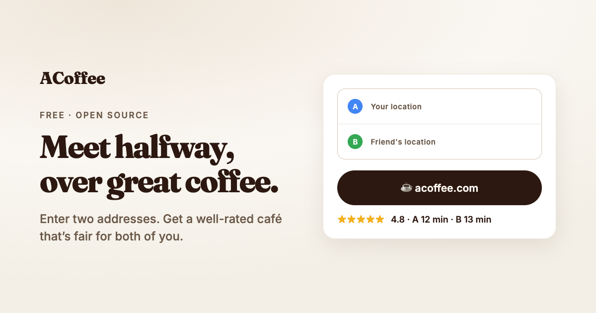

<div align="center">

# ACoffee

**Meet halfway, over great coffee.**

Enter two or three addresses. ACoffee finds a well-rated café that's fair for everyone —
ranked by each person's real travel time, not just the dot in the middle of the map.

[**acoffee.com**](https://acoffee.com) · Free · No sign-up · Open source

English · [日本語](README.ja.md) · [简体中文](README.zh-CN.md)

<sub>ACoffee is an independent project and is not affiliated with Buy Me a Coffee (buymeacoffee.com).</sub>



</div>

## Why

"Where should we meet?" usually ends with one person travelling twice as far. The geographic
midpoint doesn't help much either: it can land in a park, a river, or a stop with no direct train
for one of you. ACoffee searches around the middle of the group, then ranks real cafés by how
evenly the trip is shared.

## Features

- **Fair meetup spots for 2–3 people.** Ranked by each person's real public-transit time, with a fairness score that shows how even the trip is.
- **Search modes:** 🤝 Fair · ⚡ Fast (least total travel) · ✨ Vibe · 🌙 Quiet · 🕐 Now.
- **Plan for a meeting time.** "Saturday 3 pm" — cards show whether each café is open *then*, judged on the café's own clock (so planning a trip abroad works too).
- **Review summaries.** A two-line take on atmosphere, seating, wifi and crowds, summarised from Google reviews.
- **Send a proposal.** Share a link with the café and time; your friend can accept, shift the time, or pick the next café — no account needed for either of you.
- **Smart address matching.** Ambiguous names ("Central Park, New York") are resolved near the other person instead of the geocoder's global top hit.
- **Near me.** Top-rated coffee around your current location.
- **Coffee Passport.** Stamp the cafés you visit, add notes and ratings, and see your map and streak. Works without an account; syncs across devices when you sign in.
- **Public profile** at `acoffee.com/yourname` (optional), with a featured café and one-tap coffee booking.
- **English, 日本語, 简体中文**, installable as a PWA.

## Tech stack

| Layer | Tech |
| --- | --- |
| Frontend | React 19, TypeScript, Vite, CSS Modules, PWA (vite-plugin-pwa) |
| Backend | Cloudflare Pages Functions |
| Data | Cloudflare D1 (SQLite) + Drizzle ORM · KV (API cache) · R2 (avatars, place photos) |
| Auth | Better Auth — email magic link (Resend), optional Google sign-in |
| Maps | Google Maps Platform — Maps JS, Places (New), Geocoding, Routes |
| AI | DeepSeek V4 Flash via the Vercel AI SDK (review summaries) |

## Getting started

Requirements: Node.js 22 (the version CI uses), a Google Maps Platform API key, and (for the API) the Wrangler CLI that ships as a dev dependency.

```bash
git clone https://github.com/nomadcafe/acoffeemeetup.git
cd acoffeemeetup
npm install

cp .env.example .env              # browser-side keys (VITE_*)
cp .dev.vars.example .dev.vars    # server-side secrets for wrangler

# Create the local D1 tables
npx wrangler d1 migrations apply acoffee-dev --local
```

Then either:

```bash
npm run dev        # UI only (Vite) — search, map and passport work; /api calls don't
npm run pages:dev  # UI + API: Vite on :5173 proxies /api to wrangler on :8788
```

Open **http://localhost:5173**. If your Maps key is restricted by HTTP referrer, allow `localhost:5173`.

### Environment variables

**Browser (`.env`)**

| Name | Required | Purpose |
| --- | --- | --- |
| `VITE_GOOGLE_MAPS_API_KEY` | yes | Maps JS, Places (New), Geocoding |
| `VITE_GOOGLE_MAPS_MAP_ID` | recommended | Needed for map markers (Advanced Markers) |
| `VITE_AUTH_ENABLED` | no | `true` to show sign-in and enable passport sync |
| `VITE_GA_MEASUREMENT_ID` | no | Google Analytics 4 |

**Server (`.dev.vars` locally, Cloudflare Pages env vars in production)**

| Name | Required | Purpose |
| --- | --- | --- |
| `GOOGLE_MAPS_SERVER_KEY` | for travel times / photos | Server key for Routes, Places, Geocoding (falls back to the browser key) |
| `DEEPSEEK_API_KEY` | for summaries | Review summaries; `AI_SUMMARY_MODEL` overrides the model |
| `AUTH_SECRET`, `AUTH_BASE_URL` | for sign-in | Better Auth session signing and callback origin |
| `RESEND_API_KEY`, `RESEND_FROM_EMAIL` | for sign-in | Magic-link and booking emails |
| `GOOGLE_OAUTH_CLIENT_ID`, `GOOGLE_OAUTH_CLIENT_SECRET` | no | Google sign-in |
| `CRON_SECRET` | no | Protects the cleanup cron endpoint |
| `ROUTES_DAILY_ELEMENT_CAP`, `PLACE_PHOTO_DAILY_CAP` | no | Daily spend ceilings for public Google proxies (defaults 10,000 / 2,000) |

## Scripts

| Command | What it does |
| --- | --- |
| `npm run dev` | Vite dev server (UI only) |
| `npm run pages:dev` | Vite + `wrangler pages dev` (UI and API) |
| `npm run build` | Type-check and build to `dist/` |
| `npm run typecheck` | Type-check the app and the Pages Functions |
| `npm run lint` | ESLint |

## Project structure

```
src/            React app — components, context (app + i18n), i18n/locales (en / ja / zh), utils
functions/      Cloudflare Pages Functions
  api/          REST endpoints (places, ai, auth, account, passport, proposals, bookings, …)
  _lib/         auth, D1 schema + migrations, Google Maps client, rate limit, spend cap
  _middleware.ts  per-locale SEO / link-preview tags, profile Open Graph
public/         static assets, _headers (CSP), share images
```

## Deployment

The app runs on Cloudflare Pages (build `npm run build`, output `dist/`). Bindings are declared in
`wrangler.toml`: `DB` (D1), `ROUTES_CACHE` (KV), `AVATARS` and `PLACE_PHOTOS` (R2). Set the server
variables above in the Pages dashboard, then apply migrations to production:

```bash
npx wrangler d1 migrations apply <your-prod-db> --remote --env production
```

Cost guardrails worth setting on your own Google Cloud project: daily quotas on Places API (New)
(`GetPlaceRequest`, `SearchNearbyRequest`) and a billing budget alert.

## Contributing

Issues and pull requests are welcome. Before opening a PR, please run `npm run lint`, `npm run typecheck` and `npm run build` — CI runs the same three.

## License

[MIT](LICENSE) © nomadcafe
